# System Architecture & Dependency Impact Graph

This document serves as the **Single Source of Truth (SSOT)** for the system architecture, component dependency hierarchy, rendering pipelines, and change blast radius of the **Academy Academic Website Engine**.

Use this specification before refactoring, renaming, or modifying any template, data schema, collection, or stylesheet to prevent 404 routing errors, broken layouts, or build failures.

---

## 1. Core Architecture Principles

1. **GitHub Pages Native (Zero Custom Ruby Gems)**:
   - Compiles strictly with GitHub Pages standard dependencies (`jekyll`, `jekyll-redirect-from`, `jekyll-feed`, `kramdown`).
   - Advanced functionality (modular multi-file courseware assembly, dynamic bilingual routing, BiBTeX citation generation, responsive timetable generation, and language-isolated filtering) is executed entirely via native Liquid filters, pure SCSS, and vanilla ES6 client-side modules.

2. **Decoupled 4-Layer System Hierarchy**:
   - **Layer 1: Configuration & Structured Data**: Central config (`_config.yml`), centralized social & academic identity (`_data/socials.yml`), bilingual interface localization (`_data/locales/{tr,en}.yml`), and compact CV collections (`_educations/`, `_awards/`, etc.).
   - **Layer 2: Asset & Utility Pipelines**: Native Sass stylesheet compilation (`_sass/`, `assets/css/master.scss`), crisp vector SVG icon sprite system (`_includes/icon.html`, `_includes/icons-sprite.svg`), ES6 JavaScript bundling, and automated Python CLI utilities (`scripts/`).
   - **Layer 3: Reusable Partials & Layout Templates**: Semantic HTML5 layout templates (`_layouts/`) and modular Liquid partials (`_includes/`), featuring dedicated academic print engines and dynamic content aggregators.
   - **Layer 4: Target Content, Modular Courseware & Public Endpoints**: Localized markdown pages (`pages/tr/`, `pages/en/`), modular course directories (`_lessons/`), scholarly publications (`_publications/`), blog posts (`_posts/`), and machine-readable AI manifests (`llms.txt`, `llms-full.txt`, `ai.json`).

3. **Dynamic Folder-Driven Bilingual Isolation (TR / EN)**:
   - Navigation menus are computed dynamically by inspecting `pages/tr/` vs `pages/en/` without hardcoded navigation tables.
   - Content archives (`/dersler/` vs `/en/lessons/`, `/yayinlar/` vs `/en/publications/`, `/yazilar/` vs `/en/posts/`) strictly isolate tags, category counts, and pagination per active language.
   - Cross-language switching matches counterpart documents via `ref:`, `slug:`, or `translation_url`, with automated section-level 404 fallbacks.

4. **Zero-Font Performance & Crisp Vector Icons**:
   - Heavy legacy font files (`fontawesome-webfont.*`, `academicons.*`) and static vendor stylesheets (`bootstrap.css`, `js_composer.min.css`) have been eliminated.
   - All social, academic, and UI icons render via inline SVG `<use>` references pointing to a cached, zero-overhead SVG sprite (`_includes/icons-sprite.svg`).

5. **Dual Academic Print Architecture**:
   - High-contrast, strictly monochrome print stylesheets (`_sass/_print.scss`) automatically transform the Homepage into a standard **US Academic Curriculum Vitae** and single course pages into an official **University Course Syllabus**.

---

## 2. Visual Architecture & Pipeline Dependency Graph

```mermaid
flowchart TD
    %% ==========================================
    %% LAYER 1: CONFIGURATION & DATA
    %% ==========================================
    subgraph L1["Layer 1: Configuration & Structured Data"]
        CFG["_config.yml<br/>(Global Routes, Collections, Site Defaults)"]
        SOC["_data/socials.yml<br/>(Centralized SNS, ORCID, Scholar, GitHub)"]
        LOC_TR["_data/locales/tr.yml<br/>(TR UI Interface Dictionary)"]
        LOC_EN["_data/locales/en.yml<br/>(EN UI Interface Dictionary)"]

        subgraph CompactCollections["Compact CV Collections (output: false)"]
            COL_EDU["_educations/"]
            COL_AWD["_awards/"]
            COL_POS["_academic_positions/"]
            COL_CNF["_conferences/"]
            COL_EXP["_experiences/"]
            COL_MEM["_memberships/"]
            COL_CRT["_certificates/"]
            COL_PER["_person/"]
        end
    end

    %% ==========================================
    %% LAYER 2: ASSET & UTILITY PIPELINE
    %% ==========================================
    subgraph L2["Layer 2: Asset & Utility Pipeline"]
        SAS_MST["assets/css/master.scss<br/>(Native Sass Entrypoint)"]
        SAS_PRT["_sass/_print.scss<br/>(US CV & Syllabus Print Engine)"]
        SAS_PRT --> SAS_MST
        
        SVG_SPR["_includes/icons-sprite.svg<br/>(Central Vector SVG Sprite)"]
        INC_ICO["_includes/icon.html<br/>(SVG Icon Helper: use href='#icon-name')"]
        SVG_SPR --> INC_ICO

        SCR_VER["scripts/verify_network.py<br/>(Front-Matter Linter & Network CI)"]
        SCR_ORC["scripts/sync_orcid.py<br/>(Zero-Config Crossref/ORCID Sync)"]
        SCR_BND["scripts/bundle_js.py<br/>(ES6 JavaScript Module Bundler)"]
    end

    %% ==========================================
    %% LAYER 3: LAYOUT TEMPLATES & PARTIALS
    %% ==========================================
    subgraph L3["Layer 3: Templates & Reusable Partials"]
        INC_HEAD["_includes/head.html<br/>(SEO, Scholar Meta, OpenGraph, master.css)"]
        INC_SIDEBAR["_includes/sidebar.html<br/>(Profile, Dynamic Institution, Socials)"]
        INC_NAV["_includes/navigation.html<br/>(Folder-Driven Menu: pages/lang/)"]
        INC_SWT["_includes/language-switcher.html<br/>(Resilient Switcher + 404 Fallback)"]
        INC_FOOTER["_includes/footer.html<br/>(Copyright, bundle.js)"]

        subgraph Layouts["Structural HTML Layouts (_layouts/)"]
            LAY_DEF["_layouts/default.html<br/>(Root HTML shell, SVG sprite embed)"]
            LAY_HOME["_layouts/homepage.html<br/>(Dynamic Academic CV View)"]
            LAY_PAGE["_layouts/page.html<br/>(Static Page Container)"]
            LAY_LES_SNG["_layouts/lesson/single.html<br/>(Modular Syllabus Dynamic Aggregator)"]
            LAY_LES_ARC["_layouts/lesson/archive.html<br/>(Courseware Catalog Grid)"]
            LAY_PUB_SNG["_layouts/publication/single.html<br/>(Publication Hero, DOI, BiBTeX)"]
            LAY_PUB_ARC["_layouts/publication/archive.html<br/>(Scholarly Publication Archive)"]
            LAY_PST_SBR["_layouts/post/sidebar.html<br/>(Article Reading Scaffold + Share Bar)"]
            LAY_PST_SNG["_layouts/post/single.html<br/>(Individual Post Container)"]
            LAY_PST_ARC["_layouts/post/archive.html<br/>(Localized Blog Archive Grid)"]
        end
    end

    %% ==========================================
    %% LAYER 4: TARGET CONTENT & PUBLIC ENDPOINTS
    %% ==========================================
    subgraph L4["Layer 4: Target Content & Public Endpoints"]
        subgraph StaticPages["Symmetrical Pages (pages/)"]
            PG_TR_INDEX["pages/tr/index.md -> /"]
            PG_EN_INDEX["pages/en/index.md -> /en/"]
            PG_PAGES_TR["pages/tr/*.md -> /akademik/, /iletisim/, etc."]
            PG_PAGES_EN["pages/en/*.md -> /en/academic/, /en/contact/, etc."]
        end

        subgraph ModularCourseware["Modular Courseware (_lessons/)"]
            LES_MAIN["_lessons/{lang}/{slug}/{slug}.md<br/>(Course Master Manifest)"]
            LES_SUB["_lessons/{lang}/{slug}/*.md<br/>(01-outcomes, 02-policy, week-*.md)"]
            LES_SUB --> LES_MAIN
        end

        subgraph ScholarlyAndBlog["Collections (_publications/ & _posts/)"]
            COL_PUB["_publications/{lang}/*.md<br/>(Journal, Conference, Book)"]
            COL_PST["_posts/{lang}/*.md<br/>(Bilingual Essays & Notes)"]
        end

        subgraph AIEndpoints["AI Semantic Endpoints (Root)"]
            AI_TXT["llms.txt & llms-full.txt<br/>(Markdown Digest for LLMs)"]
            AI_JSON["ai.json<br/>(Structured JSON Schema API)"]
        end
    end

    %% ==========================================
    %% PIPELINE LINKAGES
    %% ==========================================
    CFG -.-> L3
    CFG -.-> L4
    SOC --> INC_SIDEBAR
    SOC --> SCR_ORC
    LOC_TR --> L3
    LOC_EN --> L3

    CompactCollections --> LAY_HOME
    INC_HEAD --> LAY_DEF
    INC_SIDEBAR --> LAY_DEF
    INC_NAV --> INC_SIDEBAR
    INC_SWT --> INC_SIDEBAR
    INC_ICO --> INC_SIDEBAR
    INC_ICO --> LAY_LES_SNG
    INC_ICO --> LAY_PUB_SNG
    INC_FOOTER --> LAY_DEF

    LAY_DEF --> LAY_HOME
    LAY_DEF --> LAY_PAGE
    LAY_DEF --> LAY_LES_SNG
    LAY_DEF --> LAY_LES_ARC
    LAY_DEF --> LAY_PUB_SNG
    LAY_DEF --> LAY_PUB_ARC
    LAY_DEF --> LAY_PST_SBR
    LAY_PST_SBR --> LAY_PST_SNG
    LAY_DEF --> LAY_PST_ARC

    LAY_HOME --> PG_TR_INDEX
    LAY_HOME --> PG_EN_INDEX
    LAY_LES_SNG --> LES_MAIN
    LAY_PUB_SNG --> COL_PUB
    LAY_PST_SNG --> COL_PST
```



---

## 3. Subsystem Architecture

### 3.1 Modular Lesson Content Separation (`_lessons/`)
Rather than maintaining monolithic single markdown files containing 14 weeks of lecture notes and syllabi, courses are divided into clean, decoupled sub-documents:

```
_lessons/
└── tr/
    └── bte311/
        ├── bte311.md            <- Master course entry (layout: lesson/single)
        ├── 01-outcomes.md       <- Course outcomes & competencies (section_type: outcomes)
        ├── 02-policy.md         <- Course policies & grading breakdown (section_type: policy)
        ├── week-01.md           <- Weekly topic & practical tasks (section_type: week, order: 1)
        ├── week-02.md           <- Weekly topic & practical tasks (section_type: week, order: 2)
        └── ...
```

#### Runtime Assembly Engine:
1. `_layouts/lesson/single.html` extracts the current course directory by analyzing `page.path`.
2. It queries `site.lessons` for all sub-documents sharing that directory path.
3. Documents are categorized into metadata scopes (`outcomes`, `policy`, `week`, `exam`).
4. Weekly units are sorted numerically by their `order:` front-matter attribute and rendered sequentially into the unified syllabus view, complete with expandable `<details>` modules, learning goals, and assignment directives.
5. In print mode, `_sass/_print.scss` formats this assembled document as an official university Course Syllabus.

---

### 3.2 Centralized Social & Scholarly Networks (`_data/socials.yml`)
All academic identifiers, citation databases, developer platforms, and communication channels are configured in `_data/socials.yml`:

```yaml
# Academic Profiles
orcid: "0000-0002-1825-0097"
google_scholar: "https://scholar.google.com/citations?user=..."
researchgate: "https://www.researchgate.net/profile/..."
academia: "https://independent.academia.edu/..."

# Developer & Social
github: "https://github.com/..."
linkedin: "https://www.linkedin.com/in/..."
x: "https://x.com/..."
email: "author@university.edu"
```

- **Sidebar Integration**: `_includes/sidebar.html` loops over `site.data.socials`, automatically rendering standard vector icons via ``.
- **ORCID Formatter**: Bare 16-digit ORCID handles (`0000-0002-xxxx-xxxx`) automatically resolve to canonical `https://orcid.org/0000-0002-xxxx-xxxx` URLs in UI anchors and schema tags.
- **CLI Sync Utility**: `scripts/sync_orcid.py` reads `orcid:` directly from `_data/socials.yml` to query Crossref and ORCID public APIs.

---

### 3.3 Zero-Font Vector SVG System
Web font icon kits (`fontawesome-webfont.*`, `academicons.*`) are replaced with an optimized inline SVG sprite architecture:

- **Central Sprite (`_includes/icons-sprite.svg`)**: Embedded once at the top of `_layouts/default.html` inside an invisible SVG `<defs>` block.
- **Helper Include (`_includes/icon.html`)**:
  ```liquid
  
  ```
  Renders:
  ```html
  <svg class="icon icon-orcid icon-sm" aria-hidden="true" focusable="false">
    <use href="#icon-orcid"></use>
  </svg>
  ```
- **Performance Benefits**: Eliminates render-blocking FOIT (Flash of Invisible Text), cuts ~400KB of binary webfont downloads, and renders sharp at all DPI scaling levels.

---

### 3.4 Smart Cross-Language Switcher with 404 Fallback
The language switcher (`_includes/language-switcher.html`) ensures that switching between Turkish and English never lands on a 404 error page:

1. **Exact Counterpart Matching**:
   - Inspects `ref:`, `slug:`, and `translation_url:` front-matter properties.
   - Searches `site.pages`, `site.posts`, `site.publications`, and `site.lessons` in the opposite language (`current_lang == 'tr' ? 'en' : 'tr'`).
2. **Graceful Section Fallback**:
   - If an exact counterpart page does not exist:
     - Publications fallback: `/en/publications/` or `/yayinlar/`
     - Lessons fallback: `/en/lessons/` or `/dersler/`
     - Blog posts fallback: `/en/posts/` or `/yazilar/`
     - All other pages fallback: `/en/` or `/`

---

### 3.5 Academic Print Engine (`_sass/_print.scss`)
Native print styles ensure that browser printing (`Cmd + P` / `Ctrl + P`) or PDF exports produce official, high-contrast academic documents:

- **Monochrome Reset**: Enforces `color: #000 !important; background: transparent !important;` across all elements, disabling shadows, gradients, and dark mode overrides.
- **UI Element Suppression**: Suppresses `header`, `footer`, `nav`, `.navbar`, `.sidebar`, `.language-switcher`, `.btn`, search inputs, and pagination controls.
- **Homepage -> US Academic Curriculum Vitae**:
  - Formats personal profile, affiliations, education, academic appointments, awards, and certifications into a clean, single/multi-page academic CV with standard serif typography (`Times New Roman`).
- **Lesson Page -> Academic Course Syllabus**:
  - Strips interactive timetable bars and drawer buttons.
  - Automatically unfolds all `<details>` and `<summary>` accordion units so the full weekly schedule, grading policies, and competencies print in full.
  - Generates course syllabus headers with course title, semester, instructor info, and weekly breakdown tables.

---

### 3.6 Automated CI Validation & Linter Suite (`scripts/verify_network.py`)
`scripts/verify_network.py` serves as both an automated CI front-matter linter and an academic network health checker:

```bash
python3 scripts/verify_network.py
```

- **Scope & Validation Rules**:
  - `_publications/`: Requires `title`, `date` (`YYYY-MM-DD`), and `lang` (`tr`|`en`). Verifies valid `entryType` (`article`, `inproceedings`, `book`, etc.) and guards against duplicate DOIs.
  - `_lessons/`: Main course manifests must define `layout: lesson/single`. Modular week files must contain `title`, `order` (integer), and `topic`.
  - `_posts/`: Requires `title`, `date`, and `lang`.
- **Exit Codes**: Returns `0` on clean pass; returns `1` with explicit file paths and missing attributes on failure, blocking broken PRs in GitHub Actions.

---

## 4. Front-End Asset Architecture

### 4.1 Native SCSS Pipeline
All styles are compiled by Jekyll via `assets/css/master.scss`, pulling from modular partials in `_sass/`:

| Partial Path | Scope & Responsibility |
|:---|:---|
| `_sass/_color.scss` | CSS custom property tokens, palettes, dark/light contrast rules. |
| `_sass/_typography.scss` | Typographic scale, headings, font stacks, and SVG `.icon` dimensions. |
| `_sass/_layout.scss` | Core grid wrappers, responsive scaffolding, mobile breakpoints. |
| `_sass/_sidebar.scss` | Persistent sidebar, author portrait, and dynamic institution badge. |
| `_sass/_navigation.scss`| Folder-driven menu typography, active states, mobile toggles. |
| `_sass/_social.scss` | Academic & social SVG icon link styling. |
| `_sass/_homepage.scss` | One-page academic CV layout, timeline components, compact cards. |
| `_sass/_publication.scss`| Publication hero, DOI badges, instant BiBTeX box, citation styling. |
| `_sass/_lesson.scss` | Course syllabus layout, weekly breakdown grids, timetable pills. |
| `_sass/_print.scss` | **Academic Print Engine** for US CVs and Course Syllabi. |

### 4.2 Modular Vanilla ES6 JavaScript (`assets/js/modules/`)
Interactive features run with zero third-party framework dependencies, bundled into `assets/js/bundle.js` via `scripts/bundle_js.py`:

- **`navigation.js`**: Mobile drawer toggle, off-canvas backdrop handling, and keyboard accessibility.
- **`scroll.js`**: Smooth scrolling for intra-page anchor links with sticky header offset compensation.
- **`archive.js`**: Instant client-side live search and multi-tag filtering across post, publication, and lesson archives.
- **`lesson.js`**: Dynamic headings scanner (`h2`/`h3`) generating one-click syllabus navigation pills in `.lesson-timetable-bar`.
- **`publications.js`**: BiBTeX copy-to-clipboard actions and citation format toggling.
- **`accordion.js`**: Accessible accordion expand/collapse mechanics for syllabus weeks and course units.

---

## 5. Exhaustive Blast Radius & File Impact Matrix

| File / Directory Path | Role & System Responsibility | Upstream Ingestion | Downstream Dependents | Public Output Impacted | Change Blast Radius |
|:---|:---|:---|:---|:---|:---|
| **`_config.yml`** | Global engine configuration: URLs, collections, permalinks, plugin registry. | Jekyll Core | All layouts, includes, pages, collections | **Entire website globally** | `🔴 Critical Engine` |
| **`_data/socials.yml`** | Central registry for ORCID, Google Scholar, GitHub, LinkedIn, Email. | User / Editor | `_includes/sidebar.html`, `scripts/sync_orcid.py` | Sitewide sidebars, footers, profile schemas, ORCID sync | `🟠 High` |
| **`_data/locales/{tr,en}.yml`** | UI interface dictionaries for navigation, buttons, syllabus labels. | Translators | `_includes/*`, `_layouts/*` | All localized UI labels in respective language | `🟡 Medium` |
| **`_includes/icon.html`** | Reusable SVG icon renderer (`<svg><use href="#..."></svg>`). | Layouts / Partials | `_includes/icons-sprite.svg` | Sitewide iconography across cards, buttons, sidebars | `🟠 High` |
| **`_includes/icons-sprite.svg`** | Vector SVG definitions for all social, academic, and UI icons. | `_includes/icon.html` | `_layouts/default.html` | Sitewide vector icon rendering | `🟠 High` |
| **`_includes/navigation.html`** | Scans `pages/{lang}/` to dynamically construct localized menu trees. | `_includes/sidebar.html` | `pages/tr/*.md`, `pages/en/*.md` | Navigation bars on desktop and mobile viewports | `🟠 High` |
| **`_includes/language-switcher.html`** | Resolves translation counterparts via `ref`/`slug` with section 404 fallbacks. | `_includes/sidebar.html` | `site.pages`, `site.posts`, `site.lessons`, `site.publications` | Flag switcher in sidebar footer on every page | `🟠 High` |
| **`_layouts/default.html`** | Master HTML scaffold (`<html>`, `<head>`, `#wrapper`, `#main`, SVG sprite). | All child layouts | `_includes/head.html`, `sidebar.html`, `footer.html` | **Every single page on the site** | `🔴 Critical` |
| **`_layouts/homepage.html`** | Renders dynamic one-page academic CV with category suppression. | `pages/{lang}/index.md` | Compact collections (`_educations/`, etc.) | Root landing pages (`/` and `/en/`) | `🟠 High` |
| **`_layouts/lesson/single.html`** | Assembles modular course sub-documents into an interactive course syllabus. | `_lessons/{lang}/{slug}/` | `_includes/lesson/*`, `_sass/_lesson.scss` | All course URLs (`/dersler/:slug/`, `/en/lessons/:slug/`) | `🟠 High` |
| **`_layouts/publication/single.html`**| Single publication layout with `.publication-hero`, DOI badges, BiBTeX. | `_publications/` | `_includes/icon.html`, `assets/js/modules/publications.js` | All publication URLs (`/yayinlar/:slug/`, `/en/publications/:slug/`) | `🟡 Medium` |
| **`_sass/_print.scss`** | Academic print stylesheets for US Academic CV and University Syllabus. | `assets/css/master.scss`| Browser print dialog (`Cmd + P` / `Ctrl + P`) | Physical prints and PDF exports of homepage & courses | `🟡 Medium` |
| **`scripts/verify_network.py`** | CI front-matter linter and academic network health validation script. | GitHub Actions CI | `_publications/`, `_lessons/`, `_posts/` | Pull request validation and deployment gatekeeping | `🟠 High` |
| **`scripts/sync_orcid.py`** | Fetches scholarly works from ORCID/Crossref APIs into markdown. | Editor / CLI | `_data/socials.yml`, `_publications/` | Generates/updates publication markdown documents | `🟡 Medium` |

---

## 6. Developer Pre-Flight Audit Runbook

Run these checks locally prior to committing changes or opening a pull request:

### 1. Execute Markdown Front-Matter & Network Linter
```bash
python3 scripts/verify_network.py
```
*Guarantees zero malformed front-matter blocks, validates required keys, and verifies lesson sequencing.*

### 2. Verify Jekyll Site Compilation
```bash
export LANG=en_US.UTF-8 LC_ALL=en_US.UTF-8
bundle exec jekyll build --trace
```
*Ensures all Liquid tags, collection loops, and SCSS modules compile with zero errors.*

### 3. Audit Dynamic Navigation Page Discovery
```bash
bundle exec ruby -rjekyll -e '
site = Jekyll::Site.new(Jekyll.configuration({"source" => "."}))
site.read
puts "=== TR PAGES ==="
site.pages.select { |p| p.path.start_with?("pages/tr/") && !p.data["nav_exclude"] }.sort_by { |p| p.data["nav_order"] || 99 }.each { |p| puts "#{p.data["nav_order"]} | #{p.data["nav_title"] || p.data["title"]} -> #{p.url}" }
puts "=== EN PAGES ==="
site.pages.select { |p| p.path.start_with?("pages/en/") && !p.data["nav_exclude"] }.sort_by { |p| p.data["nav_order"] || 99 }.each { |p| puts "#{p.data["nav_order"]} | #{p.data["nav_title"] || p.data["title"]} -> #{p.url}" }
'
```

### 4. Test Academic Print Layouts
- Open `/` in your browser and press `Cmd + P` (or `Ctrl + P`) to verify the clean, serif US Academic CV format.
- Open any lesson page (e.g., `/dersler/bte311/`) and open the print preview to verify the unrolled academic syllabus format.
