# System Architecture & Dependency Impact Graph

This document serves as the **Single Source of Truth (SSOT)** for the architecture, component dependencies, and change blast radius of the **Academy Academic Website Engine**.

Use this guide before refactoring, renaming, or modifying any template, configuration setting, collection, or localization dictionary to prevent 404 routing errors, broken layouts, or Jekyll build failures.

---

## 1. Core Architecture Principles

1. **Zero Custom Ruby Plugins (GitHub Pages Native)**:
   - The entire website compiles strictly with standard GitHub Pages dependencies (`jekyll`, `jekyll-redirect-from`, `jekyll-feed`, `kramdown`).
   - Complex behaviors (dynamic multilingual routing, category aggregation, headings-driven syllabus navigation, related content filtering) are executed purely through Liquid templates and vanilla ES6 client-side modules.

2. **Decoupled 4-Layer Hierarchy**:
   - **Layer 1: Configuration & Structured Data**: Central site configuration (`_config.yml`), UI localization dictionaries (`_data/locales/`), compact data collections (CV items), and author personas (`_person/`).
   - **Layer 2: Reusable Partials (`_includes/`)**: Modular widgets, navigation engines, and section-specific sub-components.
   - **Layer 3: Layout Templates (`_layouts/`)**: Structural HTML scaffolds (default, page, homepage, archives, and single detail views).
   - **Layer 4: Target Content & Public Output URLs**: Symmetrical markdown pages (`pages/tr/` vs `pages/en/`) and rich content collections (`_lessons/`, `_posts/`, `_publications/`, `_project/`).

3. **Dynamic Folder-Driven Bilingual Isolation**:
   - Navigation menus are computed dynamically by scanning language folders (`pages/tr/` vs `pages/en/`) rather than static lists.
   - Archives (`/yazilar/` vs `/en/posts/`, `/yayinlar/` vs `/en/publications/`, `/dersler/` vs `/en/lessons/`) strictly isolate content, categories, badges, and post counts per active language.
   - Cross-language page switching matches corresponding documents seamlessly using shared `ref:` identifiers.

---

## 2. Visual Architecture & Pipeline Dependency Graph

```mermaid
flowchart TD
    %% ==========================================
    %% LAYER 1: CONFIGURATION & DATA
    %% ==========================================
    subgraph L1["Layer 1: Core Configuration & Data Sources"]
        CFG["_config.yml<br/><i>(Routes, Defaults, Collections, default_lang)</i>"]
        LOC_TR["_data/locales/tr.yml<br/><i>(TR UI interface dictionary)</i>"]
        LOC_EN["_data/locales/en.yml<br/><i>(EN UI interface dictionary)</i>"]
        
        subgraph CompactCollections["Compact CV Collections (output: false)"]
            COL_EDU["_educations/"]
            COL_AWD["_awards/"]
            COL_POS["_academic_positions/"]
            COL_CNF["_conferences/"]
            COL_EXP["_experiences/"]
            COL_MEM["_memberships/"]
            COL_CRT["_certificates/"]
            COL_PER["_person/"]
        end
    end

    %% ==========================================
    %% LAYER 2: REUSABLE PARTIALS (_includes/)
    %% ==========================================
    subgraph L2["Layer 2: Reusable Partials (_includes/)"]
        INC_HEAD["_includes/head.html<br/><i>(SEO, Meta, master.css)</i>"]
        INC_SIDEBAR["_includes/sidebar.html<br/><i>(Profile, Dynamic Institution, Switcher)</i>"]
        INC_NAV["_includes/navigation.html<br/><i>(Folder-Driven Menu: pages/lang/)</i>"]
        INC_SWITCHER["_includes/language-switcher.html<br/><i>(TR/EN Flag Router via ref)</i>"]
        INC_FOOTER["_includes/footer.html<br/><i>(Copyright, master.js ES6 module)</i>"]

        subgraph ModuleIncludes["Section Modules"]
            INC_LES_HDR["_includes/lesson/lesson-header.html"]
            INC_LES_TBL["_includes/lesson/lesson-timetable.html<br/><i>(Dynamic Headings Bar)</i>"]
            INC_LES_SBR["_includes/lesson/lesson-sidebar.html"]
            INC_LES_FTR["_includes/lesson/lesson-footer.html"]
            INC_PST_SBR["_includes/post/sidebar.html<br/><i>(Localized Meta, Language-Scoped Widgets)</i>"]
        end
    end

    %% ==========================================
    %% LAYER 3: LAYOUT TEMPLATES (_layouts/)
    %% ==========================================
    subgraph L3["Layer 3: Layout Templates (_layouts/)"]
        LAY_DEF["_layouts/default.html<br/><i>(HTML shell, responsive wrapper)</i>"]
        LAY_HOME["_layouts/homepage.html<br/><i>(Dynamic One-Page Academic CV)</i>"]
        LAY_PAGE["_layouts/page.html<br/><i>(Static content container)</i>"]

        subgraph LessonLayouts["Lesson Layouts"]
            LAY_LES_SNG["_layouts/lesson/single.html"]
            LAY_LES_ARC["_layouts/lesson/archive.html"]
        end

        subgraph PostLayouts["Post Layouts"]
            LAY_PST_SBR["_layouts/post/sidebar.html<br/><i>(Article Scaffold + Share Bar)</i>"]
            LAY_PST_SNG["_layouts/post/single.html"]
            LAY_PST_ARC["_layouts/post/archive.html<br/><i>(Language-Filtered Post Grid)</i>"]
        end

        subgraph PubLayouts["Publication Layouts"]
            LAY_PUB_SNG["_layouts/publication/single.html"]
            LAY_PUB_ARC["_layouts/publication/archive.html<br/><i>(Language-Filtered Pub Grid)</i>"]
        end

        subgraph ProjLayouts["Project Layouts"]
            LAY_PRJ_SNG["_layouts/project/single.html"]
            LAY_PRJ_ARC["_layouts/project/archive.html"]
        end
    end

    %% ==========================================
    %% LAYER 4: TARGET CONTENT & OUTPUT
    %% ==========================================
    subgraph L4["Layer 4: Target Content & Public Output URLs"]
        subgraph StaticPages["Symmetrical Pages (pages/)"]
            PG_TR_INDEX["pages/tr/index.md<br/><b>/</b>"]
            PG_EN_INDEX["pages/en/index.md<br/><b>/en/</b>"]
            PG_PAGES_TR["pages/tr/*.md<br/><b>/akademik/, /iletisim/, /carmen/, /dalis/</b>"]
            PG_PAGES_EN["pages/en/*.md<br/><b>/en/academic/, /en/contact/, /en/carmen/, /en/diving/</b>"]
            PG_ARC_TR["pages/tr/ archives<br/><b>/dersler/, /yazilar/, /projeler/, /yayinlar/</b>"]
            PG_ARC_EN["pages/en/ archives<br/><b>/en/lessons/, /en/posts/, /en/projects/, /en/publications/</b>"]
        end

        subgraph RichCollections["Rich Content Collections (output: true)"]
            COL_LES["_lessons/tr/* & _lessons/en/*<br/><b>/dersler/:slug/ & /en/lessons/:slug/</b>"]
            COL_PST["_posts/tr/* & _posts/en/*<br/><b>/yazilar/:date/:title/ & /en/posts/:date/:title/</b>"]
            COL_PUB["_publications/tr/* & _publications/en/*<br/><b>/yayinlar/:slug/ & /en/publications/:slug/</b>"]
            COL_PRJ["_project/*<br/><b>/projeler/:slug/</b>"]
        end
    end

    %% ==========================================
    %% PIPELINE LINKAGES
    %% ==========================================
    CFG -.->|Scoped Defaults & Permalinks| L3
    CFG -.->|Routing Rules| L4

    PG_PAGES_TR -->|Scanned dynamically when lang=tr| INC_NAV
    PG_TR_INDEX -->|Scanned dynamically when lang=tr| INC_NAV
    PG_ARC_TR -->|Scanned dynamically when lang=tr| INC_NAV

    PG_PAGES_EN -->|Scanned dynamically when lang=en| INC_NAV
    PG_EN_INDEX -->|Scanned dynamically when lang=en| INC_NAV
    PG_ARC_EN -->|Scanned dynamically when lang=en| INC_NAV

    LOC_TR --> INC_SWITCHER
    LOC_EN --> INC_SWITCHER
    LOC_TR --> INC_SIDEBAR
    LOC_EN --> INC_SIDEBAR
    LOC_TR --> INC_PST_SBR
    LOC_EN --> INC_PST_SBR

    CompactCollections --> LAY_HOME
    COL_PER --> LAY_PST_SBR
    COL_PER --> INC_PST_SBR

    INC_HEAD --> LAY_DEF
    INC_SIDEBAR --> LAY_DEF
    INC_NAV --> INC_SIDEBAR
    INC_SWITCHER --> INC_SIDEBAR
    INC_FOOTER --> LAY_DEF

    LAY_DEF --> LAY_HOME
    LAY_DEF --> LAY_PAGE
    LAY_DEF --> LAY_LES_SNG
    LAY_DEF --> LAY_LES_ARC
    LAY_DEF --> LAY_PST_SBR
    LAY_DEF --> LAY_PST_ARC
    LAY_DEF --> LAY_PUB_SNG
    LAY_DEF --> LAY_PUB_ARC
    LAY_DEF --> LAY_PRJ_SNG
    LAY_DEF --> LAY_PRJ_ARC

    LAY_PST_SBR --> LAY_PST_SNG

    INC_LES_HDR --> LAY_LES_SNG
    INC_LES_TBL --> LAY_LES_SNG
    INC_LES_SBR --> LAY_LES_SNG
    INC_LES_FTR --> LAY_LES_SNG
    INC_PST_SBR --> LAY_PST_SBR

    LAY_HOME --> PG_TR_INDEX
    LAY_HOME --> PG_EN_INDEX
    LAY_PAGE --> PG_PAGES_TR
    LAY_PAGE --> PG_PAGES_EN
    
    LAY_LES_ARC --> PG_ARC_TR
    LAY_LES_ARC --> PG_ARC_EN
    LAY_LES_SNG --> COL_LES

    LAY_PST_ARC --> PG_ARC_TR
    LAY_PST_ARC --> PG_ARC_EN
    LAY_PST_SNG --> COL_PST

    LAY_PUB_ARC --> PG_ARC_TR
    LAY_PUB_ARC --> PG_ARC_EN
    LAY_PUB_SNG --> COL_PUB

    LAY_PRJ_ARC --> PG_ARC_TR
    LAY_PRJ_ARC --> PG_ARC_EN
    LAY_PRJ_SNG --> COL_PRJ
```



---

## 3. Bilingual Routing & Content Isolation Contract

### 3.1 Dynamic Navigation Menu (`_includes/navigation.html`)
- **No Hardcoded Navigation Tables**: Menu items are dynamically queried from `site.pages` matching the active folder prefix:
  - Turkish: `pages/tr/`
  - English: `pages/en/`
- **Front Matter Controls**:
  - `nav_title:` Clean label displayed in the menu (falls back to `title`).
  - `nav_order:` Numerical sorting order (1, 2, 3...).
  - `parent:` Parent page's `ref` identifier for nested dropdown submenus.
  - `nav_exclude: true`: Hides private or unlisted pages from the menu.

### 3.2 Bidirectional Page Switcher (`_includes/language-switcher.html`)
- Every bilingual document shares a matching `ref:` property in its front matter.
- When toggling flags:
  1. Checks `site.pages` for target language matching `ref`.
  2. Checks current collection (`lessons`, `posts`, `publications`, `project`).
  3. Checks all rich collections as fallback.
  4. Falls back to target language homepage (`/` or `/en/`).

### 3.3 Dynamic Institution & Profile Resolution (`_includes/sidebar.html`)
- Profile card queries the home document corresponding to `current_lang` (`ref: home`).
- Institution dynamically displays:
  - **Turkish**: `Doğu Akdeniz Üniversitesi` (avatar links to `/`).
  - **English**: `Eastern Mediterranean University` (avatar links to `/en/`).
- Copyright statement automatically uses `locale.ui.all_rights_reserved`.

### 3.4 Language-Isolated Archive & Single Views
- **Post & Publication Archives**:
  - `site.posts` and `site.publications` are strictly partitioned into `filtered_posts` and `filtered_publications` matching `current_lang`.
  - Category badges, search bars, and post counts only consider documents within that language domain.
- **Single Post Sidebar & Footers**:
  - "Related Posts" only displays sibling articles in the same language and category.
  - "Recent Posts" and "Categories" directory only list content belonging to the active language.
  - Date formats adhere to locale: `%B %d, %Y` (English) vs `%d.%m.%Y` (Turkish).
  - Back buttons route strictly to the active archive (`/en/posts/` vs `/yazilar/`).

### 3.5 Dynamic Empty Category Suppression (`_layouts/homepage.html`)
- When rendering CV section cards (e.g. Education, Awards, Publications), the template inspects the active language collection.
- If a category has no entries for the active language, its header and section are completely suppressed, avoiding blank cards.

---

## 4. Front-End Asset Architecture

### 4.1 Modular CSS Hierarchy (`assets/css/modules/`)
Styles are structured into 24 decoupled BEM-compliant CSS modules, imported and aggregated in strict dependency order by `assets/css/master.css`:

| Module File | Component Responsibility |
| :--- | :--- |
| `color.css` | CSS custom properties, palette variables, and theme tokens. |
| `typography.css` | Font families, typographic scale, line-heights, and headings. |
| `layout.css` | Scaffold grid, responsive wrappers, container bounds. |
| `sidebar.css` | Desktop persistent sidebar & off-canvas drawer navigation. |
| `navigation.css` | Menu items, active states, hover effects, and mobile toggles. |
| `flags.css` | Multilingual flag icons and language switcher styling. |
| `profile.css` | User portrait, institution text, and author badges. |
| `social.css` | Academic and social networking icon pills. |
| `footer.css` | Sticky footer and copyright notice layout. |
| `forms.css` | Search inputs, filter fields, and contact form controls. |
| `card.css` | Base card layout, borders, soft shadows, and hover lifts. |
| `homepage.css` | Academic CV timeline sections and resume widgets. |
| `timeline.css` | Chronological education & career timeline markers. |
| `archive.css` | Course, publication, and blog post archive grid listings. |
| `single.css` | Single article reading view, typography, and meta strips. |
| `post.css` | Post body styles, code blocks, blockquotes, and callouts. |
| `publication.css` | Dedicated `.publication-hero`, DOI badges, BibTeX box, citation styles. |
| `lesson.css` | Course overview, syllabus structure, and lecture notes. |
| `lesson-panel.css` | Course metadata sidebar cards, instructor badges, and navigation bar. |
| `dates.css` | Calendar icon stamps and localized date pills. |
| `details.css` | Expandable `<details>` and course unit accordions. |
| `gallery.css` | Media grid layouts and responsive image frames. |
| `contact.css` | Contact channels, address blocks, and interactive maps. |
| `visual-composer.css`| Grid utilities, row/column alignments, and responsive helpers. |

### 4.2 ES6 JavaScript Modules (`assets/js/modules/`)
Client-side interactivity uses modern, dependency-free vanilla ES6 modules aggregated by `assets/js/master.js`:

- **`navigation.js`**: Mobile drawer toggle, off-canvas backdrop handling, and submenu click events.
- **`scroll.js`**: Smooth scrolling for intra-page anchor links with sticky header offset compensation.
- **`archive.js`**: Instant client-side live search and multi-tag filtering across post, publication, and lesson archives.
- **`lesson.js`**: Dynamic headings scanner (`h2`/`h3`), generating one-click syllabus navigation pills in `.lesson-timetable-bar`.
- **`publications.js`**: BibTeX copy-to-clipboard actions and citation format toggling.
- **`accordion.js`**: Accessible accordion expand/collapse mechanics for syllabus weeks and course units.
- **`timeline.js`**: Interactive timeline animations and reveal states on scroll.

---

## 5. Exhaustive Blast Radius & File Impact Matrix

| File / Directory Path | Role & Responsibility | Upstream Dependents | Downstream Dependencies | Public Live URLs Impacted | Change Risk Level |
| :--- | :--- | :--- | :--- | :--- | :--- |
| **`_config.yml`** | Unified configuration: personal site profile at top, framework collections & defaults below. | Jekyll Build Engine | `_layouts/`, `pages/`, plugins | **Entire website globally** (all routes, permalinks, language prefixes). | `🔴 Critical Engine` |
| **`_data/locales/tr.yml`** | Turkish UI interface dictionary: button labels, headings, metadata labels, institution names. | Partials, layouts, switcher | None | Text strings across all Turkish routes. | `🟡 Medium` |
| **`_data/locales/en.yml`** | English UI interface dictionary: button labels, headings, metadata labels, institution names. | Partials, layouts, switcher | None | Text strings across all English routes. | `🟡 Medium` |
| **`_includes/navigation.html`** | **Dynamic navigation engine:** scans `pages/[current_lang]/`, sorts by `nav_order`, builds parent/child menus. | `_includes/sidebar.html` | Front matter of `pages/tr/` & `pages/en/` | **Sitewide navigation menu** across all devices and pages. | `🟠 High` |
| **`_includes/sidebar.html`** | Off-canvas / desktop persistent sidebar: author portrait, dynamic institution, navigation, switcher. | `_layouts/default.html` | `navigation.html`, `language-switcher.html`, `locales` | **Sitewide** (main user navigation on every page). | `🟠 High` |
| **`_includes/language-switcher.html`**| Resolves translation targets between TR and EN using shared `ref` tags, falling back cleanly to root. | `_includes/sidebar.html` | `site.languages`, `site.pages`, collections | **Sitewide** (the flag switcher at sidebar footer). | `🟠 High` |
| **`_layouts/default.html`** | Root HTML scaffolding: `<!DOCTYPE>`, `<html>`, `<body>`, `#wrapper`, `#main`. | All child layouts | `head.html`, `sidebar.html`, `footer.html` | **Sitewide** (every single page on the site). | `🔴 Critical` |
| **`_layouts/homepage.html`** | Renders dynamic one-page academic CV with language detection and empty category suppression. | Used by `pages/tr/index.md` & `pages/en/index.md` | Compact collections, `locales` | Root landing pages: `/` (TR) and `/en/` (EN). | `🟠 High` |
| **`_layouts/post/sidebar.html`** | Single post reading layout: localized hero header, article body, share bar, and back button. | Used by `_layouts/post/single.html` | `_includes/post/sidebar.html`, `locales` | All individual post URLs (`/yazilar/...`, `/en/posts/...`). | `🟡 Medium` |
| **`_includes/post/sidebar.html`** | Post metadata card, localized fields, language-filtered related posts, recent posts, and categories widget. | `_layouts/post/sidebar.html` | `filtered_posts`, `locales` | All individual post sidebars. | `🟡 Medium` |
| **`_layouts/post/archive.html`** | Searchable, filterable post grid strictly partitioned by language. | `pages/tr/post.md`, `pages/en/post.md` | `assets/js/modules/archive.js` | Blog archives: `/yazilar/` and `/en/posts/`. | `🟡 Medium` |
| **`_layouts/publication/single.html`**| Single publication layout featuring dedicated `.publication-hero`, citation cards, BibTeX box. | Used by `_publications/` | `assets/css/modules/publication.css` | All individual publication URLs (`/yayinlar/...`, `/en/publications/...`).| `🟡 Medium` |
| **`_layouts/publication/archive.html`**| Filterable publication archive strictly partitioned by language. | `pages/tr/publications.md`, `pages/en/publications.md`| `assets/js/modules/archive.js` | Publication archives: `/yayinlar/` and `/en/publications/`. | `🟡 Medium` |
| **`_layouts/lesson/single.html`** | Detailed course syllabus layout: timetable bar, instructor card, learning outcomes, lecture notes. | Used by `_lessons/` | `_includes/lesson/*`, `lesson-panel.css` | All course URLs (`/dersler/...`, `/en/lessons/...`). | `🟡 Medium` |
| **`_layouts/lesson/archive.html`** | Academic course catalog grid with department and semester filters. | `pages/tr/lessons.md`, `pages/en/lessons.md` | `assets/js/modules/archive.js` | Course archives: `/dersler/` and `/en/lessons/`. | `🟡 Medium` |
| **`assets/css/master.css`** | CSS Master aggregator that imports all 24 modular stylesheets. | `_includes/head.html` | All `assets/css/modules/*.css` | **Sitewide styling and visual presentation**. | `🟠 High` |
| **`assets/js/master.js`** | ES6 module bundle consolidator initializing smooth scroll, navigation, live search, and syllabus pills. | `_includes/footer.html` | `assets/js/modules/*.js` | **Sitewide client-side interactivity and UX**. | `🟠 High` |

---

## 6. Developer Verification & Audit Runbook

Run these commands prior to submitting pull requests or pushing changes to GitHub Pages:

### 1. Audit dynamic navigation pages discovered by Jekyll
```bash
export LANG=en_US.UTF-8 LC_ALL=en_US.UTF-8
bundle exec ruby -rjekyll -e '
site = Jekyll::Site.new(Jekyll.configuration({"source" => "."}))
site.read
puts "=== TR PAGES ==="
site.pages.select { |p| p.path.start_with?("pages/tr/") && !p.data["nav_exclude"] }.sort_by { |p| p.data["nav_order"] || 99 }.each { |p| puts "#{p.data["nav_order"]} | #{p.data["nav_title"] || p.data["title"]} -> #{p.url}" }
puts "=== EN PAGES ==="
site.pages.select { |p| p.path.start_with?("pages/en/") && !p.data["nav_exclude"] }.sort_by { |p| p.data["nav_order"] || 99 }.each { |p| puts "#{p.data["nav_order"]} | #{p.data["nav_title"] || p.data["title"]} -> #{p.url}" }
'
```

### 2. Audit all shared `ref` keys across bilingual pages
```bash
grep -rn "^ref:" academy/pages/ | sort -k2
```

### 3. Verify clean Jekyll build with strict error reporting
```bash
export LANG=en_US.UTF-8 LC_ALL=en_US.UTF-8
cd academy && bundle exec jekyll build --trace
```

### 4. Verify language-isolated outputs
- Check that `/en/posts/` and `/yazilar/` contain strictly English and Turkish posts respectively.
- Verify that English single post pages display `Eastern Mediterranean University` in the sidebar and `All Posts` on back buttons.
- Verify that Turkish single post pages display `Doğu Akdeniz Üniversitesi` in the sidebar and `Tüm Yazılar` on back buttons.
